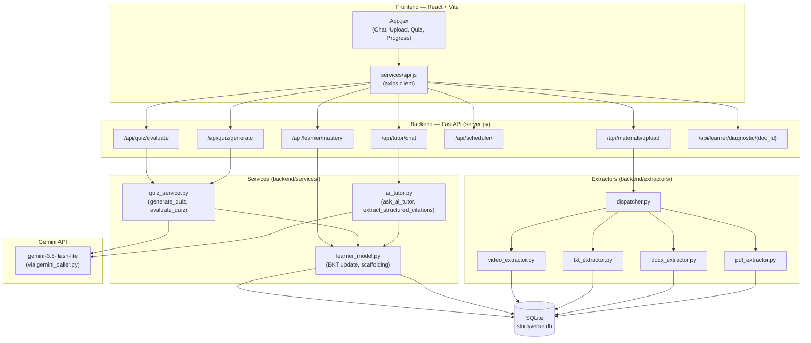
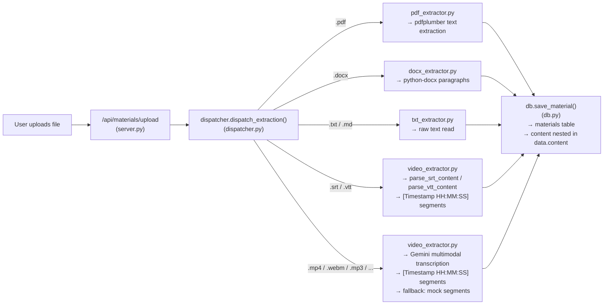
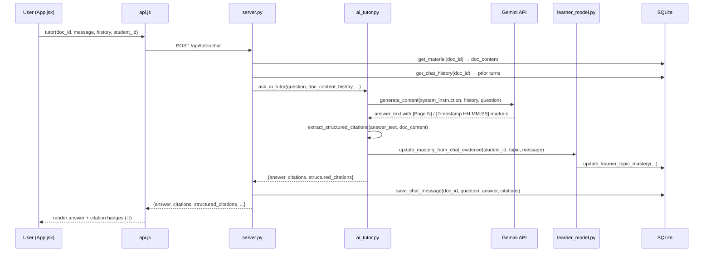
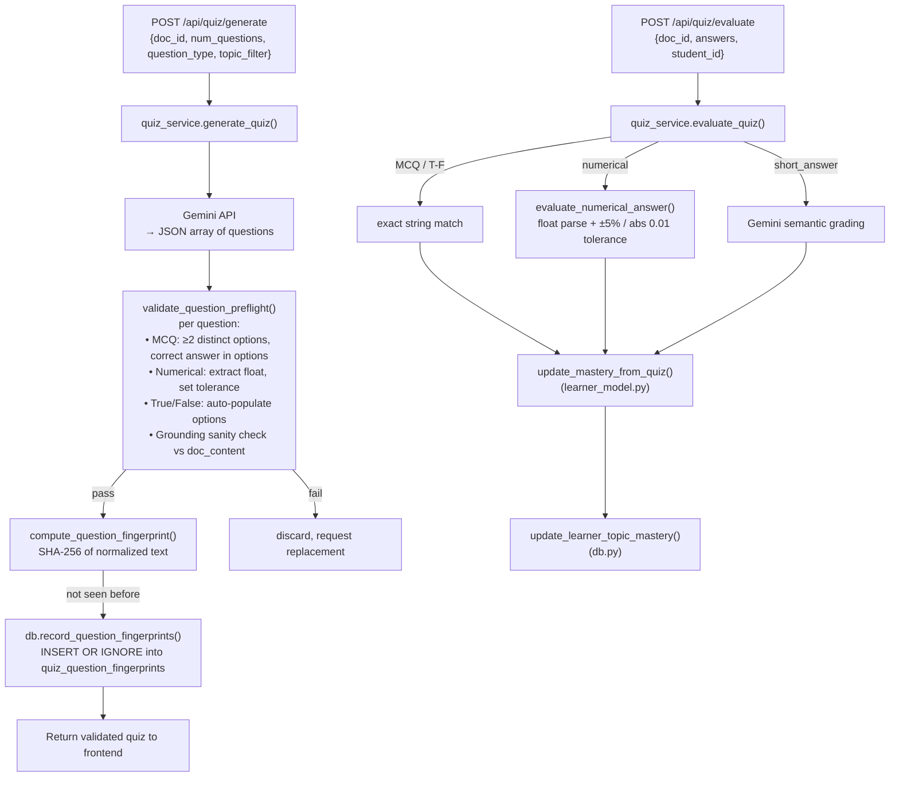
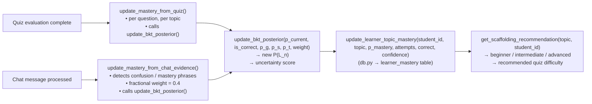

# StudyVerse — System Architecture

> **Branch:** `feature/yagnesh` | **Stack:** React + Vite (frontend), Python FastAPI (backend), SQLite (database), Gemini API (AI)

---

## High-Level Architecture

---

## 1. File Upload & Extraction Pipeline

**Key design decisions:**
- All extracted content is stored once in `materials.data` (JSON blob with `content`, `total_units`, `unit_name`).
- Video/audio content is segmented by timestamp so citations can reference `[Timestamp HH:MM:SS]` locations.
- Failed Gemini transcription falls back to mock segments — the upload always succeeds.

---

## 2. AI Tutor Chat Flow

---

## 3. Adaptive Quiz Pipeline

---

## 4. Learner Model Update Flows

---

## 5. Database Schema (Key Tables)

| Table | Purpose | Key Columns |
|-------|---------|-------------|
| `materials` | Uploaded study materials + extracted content | `id`, `name`, `type`, `data` (JSON) |
| `chat_messages` | Tutor conversation history per material | `doc_id`, `role`, `content`, `citations` |
| `quiz_results` | Per-question quiz evaluation results | `doc_id`, `student_id`, `question`, `is_correct` |
| `quiz_question_fingerprints` | SHA-256 deduplication of generated questions | `doc_id`, `fingerprint` (UNIQUE) |
| `learner_mastery` | BKT mastery state per student per topic | `student_id`, `topic`, `p_mastery`, `attempts`, `confidence` |
| `learner_events` | Append-only log of mastery update events | `student_id`, `topic`, `event_type`, `weight`, `is_correct` |
| `revision_schedule` | Spaced-repetition schedule per material | `doc_id`, `student_id`, `next_review`, `interval_days` |
| `notes` | User study notes per material | `doc_id`, `student_id`, `content` |
| `flashcards` | AI-generated flashcards per material | `doc_id`, `front`, `back` |

---

## 6. API Endpoints Summary

| Method | Path | Handler | Description |
|--------|------|---------|-------------|
| POST | `/api/materials/upload` | `server.py` | Upload and extract material |
| GET | `/api/materials` | `server.py` | List all materials |
| POST | `/api/tutor/chat` | `ai_tutor.ask_ai_tutor` | Send message to AI tutor |
| GET | `/api/tutor/history/{doc_id}` | `server.py` | Fetch chat history |
| POST | `/api/quiz/generate` | `quiz_service.generate_quiz` | Generate adaptive quiz |
| POST | `/api/quiz/evaluate` | `quiz_service.evaluate_quiz` | Evaluate quiz answers |
| GET | `/api/learner/mastery` | `server.py` | Get BKT mastery + scaffolding |
| POST | `/api/learner/diagnostic/{doc_id}` | `server.py` | Generate diagnostic intake quiz |
| GET/POST | `/api/scheduler/` | `server.py` | Revision schedule CRUD |
| GET | `/api/progress/{doc_id}` | `server.py` | Learning progress + BKT state |
| POST | `/api/notes/` | `server.py` | Create study note |
| GET | `/api/flashcards/{doc_id}` | `server.py` | Retrieve flashcards |
